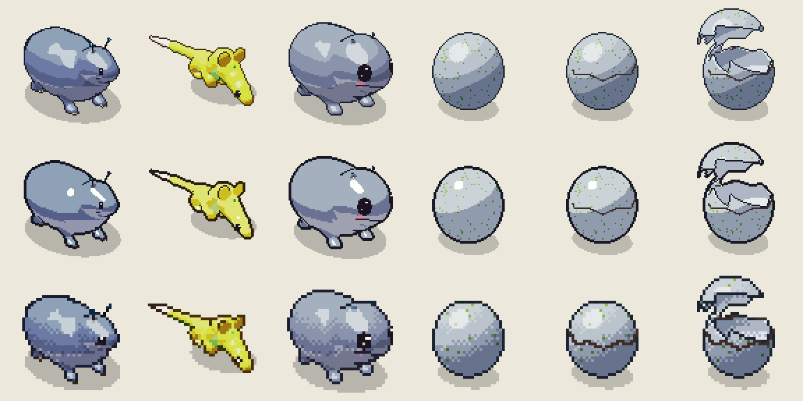
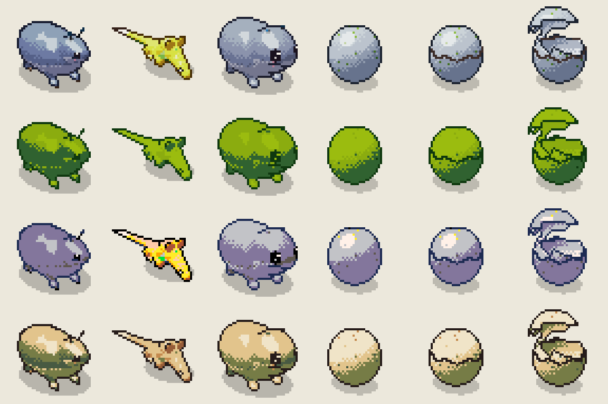
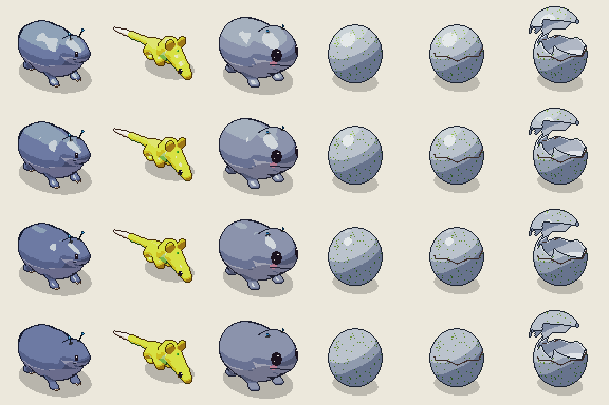

# Art style options

> **Update (pass 3): three looks kept.** Jake picked **Original** (`gochi`), **Cel** and **Pixel**, plus the **Shine** slider. Matte, Chunky, Ink and Sticker were removed from the code; their rows below are kept as the record of what was tried and why. The pixel palettes stay.

Jake finds the finished look too shiny. This note lists the looks the web model drew in pass 2, what each costs to ship in the Hatchery overlay, what stays procedural and what would need hand-made or AI art, and ends with a recommendation.

Every look below is **the same creature**: the same genome, body, pose and light. Only the last step, how a hit pixel becomes a colour, changes. Switching looks never touches the genome (tested). Each look also draws the egg, the hatching and the collection thumbnails.

Try them in the web model (`prototype/index.html`): **Style** chips (Original, Cel, Pixel), a **Palette** row for the pixel look, and a **Shine** slider. URL: `?seed=moss&level=100&style=pixel&palette=gameboy&shine=0.3`.

## The looks

Times are one 150 × 120 creature render in Node on one core (the page's sprite). The overlay's sprite is about 120 × 100, so roughly two thirds of these numbers.

| Look | What it looks like | Time | Notes |
|---|---|---|---|
| **Original** (`gochi`) | The video: four banded tones from cool shadow to warm light, a glint on glossy bodies, a 1-pixel tinted ink outline. | 56 ms | The default. At Shine 1 it is the old picture, pixel for pixel (the level and seed sheets did not change). |
| ~~**Matte**~~ (removed) | Flat paint: one body tone and one soft shadow, no glint, a softer outline from the shadow colour. Shine adds only a faint top light. | 57 ms | The direct answer to "too shiny". |
| **Cel** | Two hard tones split at the terminator, a thick dark outline (2 px), a small white highlight only on glossy bodies. | 54 ms | Cartoon or anime look; reads well at small size. |
| **Pixel** | Rendered at half resolution and blown up with nearest-neighbour, with 4 × 4 ordered (Bayer) dither between bands and a 1-pixel outline. | 16 ms | The cheapest real look: a quarter of the rays. |
| ~~**Chunky**~~ (removed) | Quarter resolution, three tones, no dither: big readable blocks like a 16 × 16 sprite. | 5 ms | Loses the face at baby size; best for large windows. |
| ~~**Ink**~~ (removed) | Paper-white body, hatching in the mid tones, cross-hatching in shadow, stippled markings, a black pen outline. | 52 ms | Wants the paper backdrop; on a dark desktop it reads as grey. |
| ~~**Sticker**~~ (removed) | Two flat tones with a little grain, a white die-cut border and a soft drop shadow: a paper cut-out or vinyl sticker. | 55 ms | Needs a few pixels of margin in the window for the border. |

**Palettes** for Pixel: the creature's own colours (default), **Game Boy** (four greens, stretched over each sprite's own dark-to-light range), **PICO-8** (16 colours) and **warm earth** (8 browns and greens). Every pixel lands exactly on a palette colour (tested).

**Shine** (0–1, default 1) is one slider for every look: it shrinks and then removes the glint, and pulls the top light band down. At 0 there is no glint at all (tested: the brightest body pixel drops).

### Looks considered and not built

- **Watercolour or gouache**: soft edges and paper bleed. It needs blur and noise passes over the whole sprite, which goes against the crisp pixel grid the overlay uses, and it costs more per frame.
- **Voxel or low-poly**: would need a mesh step (marching cubes) between the field and the picture, the thing the generation doc already rejected.
- **Claymation**: fingerprints and lumpy light. It is close to Matte plus noise; it could be added later as a Matte variant.
- **1-bit Mac**: Ink with no paper tone and a two-colour palette. It is one palette entry away if wanted.

## What stays procedural, what needs drawn or AI art

| Thing | Procedural (code) | Hand-made or AI (PixelLab) |
|---|---|---|
| Creature body, every level, every pose | **Always.** It is what makes every egg unique, lets it grow through 100 levels and lets it walk with real legs. | Not possible without losing that (below). |
| Faces (eyes, mouth, blush) | Yes (decals). | Could be a small set of hand-drawn eye and mouth sprites per look, if the procedural ones read badly in Pixel or Chunky at baby size. |
| Eggs | Yes, from the genome: tint, marks, shape, crack. | Optional: a few nest or shell textures to sample from. |
| Backgrounds, ground strip, nest | Yes since pass 3: six code-drawn habitats (`habitats.js`). | Still a **good fit** for nicer tiles and props later. |
| UI (level badge, tray icon, collection frames) | No. | **Good fit.** |

### PixelLab

PixelLab makes good pixel art from a prompt and can make consistent sets: body-part sets, eggs, backgrounds, tiles and UI pieces. What it **cannot** do is give every egg its own body. Its output is a fixed picture. A creature built from PixelLab parts would be a kit-bash of a few hundred stock parts: it would not melt into one body, could not grow smoothly through 100 levels, and could not walk with IK legs. Each new body would also cost a generation and would not be the same twice from a seed. So PixelLab fits around the creature (ground tiles, nest, egg-shell textures, UI), never for the creature itself.

The key check passed (free generations left). PixelLab was **not used in pass 2 or pass 3**: none of the looks needed it, and the pass 3 habitats are drawn in code (cheap, any size, parallax layers and wind for free, no art to check). A PixelLab tile set remains an option for the overlay's ground strip.

### The hybrid: procedural silhouette, pixel shading

The **Pixel** look is the hybrid. The genome makes a unique body, the SDF gives its exact silhouette and light, and only the last step is pixel art: a lower resolution, banded colour, ordered dither, an optional fixed palette and a 1-pixel outline. Every egg stays unique and still grows and walks, but it reads like a hand-pixelled sprite. It also renders 3–4 times faster than Original, because it casts a quarter of the rays.

## Cost to ship each look in the overlay

The three looks are entries in `render.js`, which the overlay ports as-is (build step 1 in [overlay-game-design.md](overlay-game-design.md)). So the extra work per look is small:

| Work | Size |
|---|---|
| A look in Settings (a menu like the ant farm's palettes) and saved with the pet | Half a day for all of them |
| Original, Cel, Pixel | Nothing extra |
| Palettes (own, Game Boy, PICO-8, warm earth) | A Settings submenu; nothing else |
| Shine | A Settings slider |
| PixelLab ground strip, nest and egg-shell textures | About a day, plus checking the art (free generations) |
| Hand-drawn faces for Pixel at baby size (only if needed) | A day of drawing or a PixelLab set |

## Recommendation

1. **Keep Original as the default in the web model**, as the faithful copy of the video.
2. **Ship the overlay with Pixel as its default look, in the creature's own colours, at Shine 0.3.** It fixes "too shiny" and matches the overlay, which already shows one game pixel as 2 or 4 screen pixels. It is the cheapest look to render, so it suits a pet that runs all day, and it keeps every egg unique. Offer Original and Cel in Settings, with the fixed palettes as fun themes.
3. **Use PixelLab only around the creature**: a ground strip, a nest, egg-shell textures and UI. The creatures stay procedural.
4. Ink and Sticker were dropped in pass 3 (Jake kept Original, Cel and Pixel); the git history has them if wanted.
