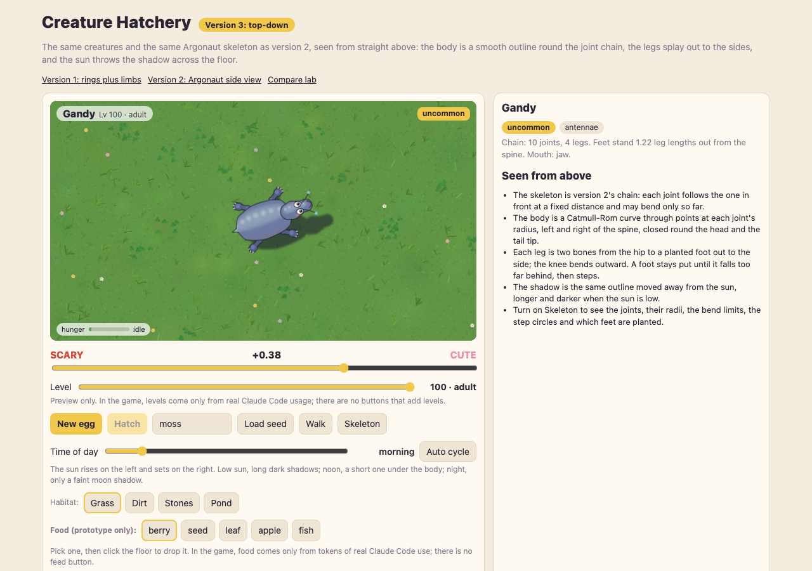

# Creatures version 3: the hatchery from above

Version 3 looks at the creature from straight above. It uses version 2's Argonaut chain, which steers the head while every other joint follows at a fixed distance and within an angle limit. The genome, colours and walk are unchanged; only the camera and the drawing are new.

Open `creatures/prototype-v3/index.html` straight from disk, or the single file `creatures/prototype-v3/creatures-v3-standalone.html`. The header links to version 1, version 2 and the compare lab.



## How it works

**The floor is the screen.**
- World x runs across the screen and world z runs down it: `sx = ox + x * scale`, `sy = oy + z * scale`.
- The page uses a 640x360 stage at 84 px per world unit.
- Version 2 already moved the walker on this (x, z) plane. From the side most of that motion was hidden; from above it is the whole picture.

**The walker is version 2's, unchanged** (`prototype-v2/motion2.js`).
- `topdown.rig(ph)` takes `chain.rig(ph)` and moves each foot out to the side: 0.72 of a leg past the hip.
- Front feet sit 0.2 of a leg ahead of the hip; hind feet sit 0.2 behind.
- The rig is passed in as `createWalker(ph, seed, { rig })`. Because the walker plants feet at `hips[i].foot` in the hip joint's frame, this one change is enough to splay the legs.
- The usual behaviour is all still there: stepping only when a foot falls too far behind, gaits by leg count, turns and spins, eating, swallowing and pooping.

**The body is a smooth outline round the chain** (`outline(w)`).
- At every joint there is a point the joint's radius to its right and one to its left.
- The outline runs down the right side, round a pointed tail tip, back up the left side, and over a round cap in front of joint 0.
- It is filled as a closed Catmull-Rom curve. The tail's spring sway (applied by version 2 only when it draws) is applied again here.
- Breathing and the swallow lump scale the widths, so the lump travels down the spine as a bulge with a darker spot.

**The head** is laid out ahead of joint 0 and turned by where the creature looks, using the genome's head rings. On it sit:
- eyes that blink;
- the five mouth kinds (jaw, beak, mandibles, slit, tongue), which open on each bite;
- ears, horns and decor, drawn from above;
- folded wings and back spikes, drawn on the body.

**Patterns and colour.**
- Spots, speckles, patches and stripes are placed by arc length along the spine and by fraction of the half-width, so they bend with the body.
- The belly colour shows only at the edges, where a side view would see it.
- The tail ends in its tip colour.
- Every colour comes from `render.palette(ph)`, the same ramps as versions 1 and 2.

**Legs** (`legIK2D(hip, foot, len, side)`).
- Each leg is two bones in the plane, with the knee bent outward.
- A swinging foot is drawn bigger and higher, so it reads as lifted toward the camera.
- Feet are rounded, with toes.

**Light.**
- `shadowOffset(sun, h)` moves a point at height h away from the light by `h * |L.xz| / L.y`, capped at 2.4 times h.
- The shadow is the same outline, with each joint shifted by its own height. Legs and feet are shifted too.
- A low sun gives a long, darker shadow; noon gives a short one under the body.
- At night the moon gives only a faint one.
- The day/night tint is version 2's `light.drawTint`.

**Styles.**
- **Original**: soft shading lit from the sun's side and a blurred shadow.
- **Cel**: flat bands and a thick ink line.
- **Pixel**: drawn at a third of the size, snapped to the genome's ramps, with a 1 px ink line and a hard shadow, then scaled up with nearest-neighbour. The floor is low-res too, and the page steps at 12 fps.

**Habitats** (`habitats3.js`).
- The four floors are grass, dirt, stones and pond. The pond has a wavy shoreline, wet sand, lily pads, reeds and ripples.
- Each floor is drawn once into a cached canvas. Swaying grass blades, ripples, glints and lapping foam move on top of it, and are held still when motion is reduced.
- On the pond, the walk area stops at the sand.

**Page** (`app3.js`).
- **Hatching, seen from above:** the egg wobbles, a zigzag crack runs across its top, and the halves fall apart. The level-1 baby hops and walks out under them.
- **Food (prototype only):** pick berry, seed, leaf, apple or fish, then click the floor. The food falls, its shadow closing in, then lies on the floor. The creature walks over, bites, chews, swallows and gets happy, and hunger falls.
- **Droppings** fade after 9 seconds.

## Same as version 2, and different

| | Version 2 (side view) | Version 3 (top-down) |
|---|---|---|
| Genome, palette, levels, temperament | same | same |
| Chain, angle limits, stepping, eating | same code | same code, passed a splayed rig |
| Feet | under the body (seen from the side) | out to the sides, lizard-like |
| Body | rings drawn along the chain, side on | Catmull-Rom outline of the radii, from above |
| Shadow | body pieces projected onto a floor line | the outline moved across the floor |
| Styles | Original, Cel, Pixel (plus palettes, shine) | Original, Cel, Pixel |
| Habitats | six, with parallax | four, flat floors |
| Collection, breeding, gene editor | yes | no |

## Side view versus top-down

**What top-down does well**
- You see the Argonaut motion itself: the S-curve as the chain follows the head, tight turns, the 180s and 360s, and each foot staying put while the body slides past it.
- Shadows read as direction and time of day at a glance.
- The whole floor is usable. Food anywhere is reachable, and it is clear where the creature is going.
- The outline cannot fold or overlap itself because the angle limits hold, so the body always reads cleanly.

**What it does less well**
- Faces get smaller. Eyes, mouths and ears are seen from above and foreshortened, and that is where most of the charm of the side view lives.
- Height is only hinted. Lifted feet, hops and flight show as size and shadow distance, not as height.
- Long-legged and tall creatures look much like short ones, and wings fold flat.
- Fewer genome traits are visible at a glance.

## Commands

From `creatures/prototype-v3/`:

```
node --test test/                                    # unit tests (and e2e.js, which runs headless Chrome)
node test/e2e.js test index.html                     # 21 in-page checks, headless Chrome
node test/e2e.js test creatures-v3-standalone.html
node tools/bundle.js                                 # writes creatures-v3-standalone.html
node tools/shots.js                                  # writes ../docs/shots-v3/v3-*.png
```

URL parameters:
- `seed`, `level`, `temperament`
- `style` (original, cel, pixel)
- `habitat` (grass, dirt, stones, water)
- `sun` (left, noon, right, night, any named time, or 0..1), `auto=1`
- `theme` (light, dark)
- `skeleton=1`, `pause=1`
- `hunger`
- `food` (one snack ahead of it), `eat` (seconds to walk it there first), `hatch` (a still that many seconds into hatching)
- `test=1`

## Screenshots

- **Styles:** `v3-original`, `v3-cel`, `v3-pixel`
- **Habitats:** `v3-grass`, `v3-dirt`, `v3-stones`, `v3-water`
- **Light and theme:** `v3-noon`, `v3-night`, `v3-dark`
- **Overlay:** `v3-skeleton`
- **Hatching:** `v3-egg`, `v3-hatching`, `v3-hatched`
- **Eating:** `v3-eating`
- **Narrow window:** `v3-narrow`

## Not done

- No collection, breeding, gene editor, palette or shine controls. Use version 2 for those.
- Version 3 has no entry in the compare lab.
- No parallax or scenery height; the floors are flat.
- Wings are drawn only folded, even while the creature flies. Flight shows only as the feet tucking and the shadow moving further off.
- The tail's lift is not drawn.
- The head's nod shows only as a small forward shift.
- The Pixel look makes new small canvases on every frame it draws (12 per second). That is cheap, but they could be pooled.
